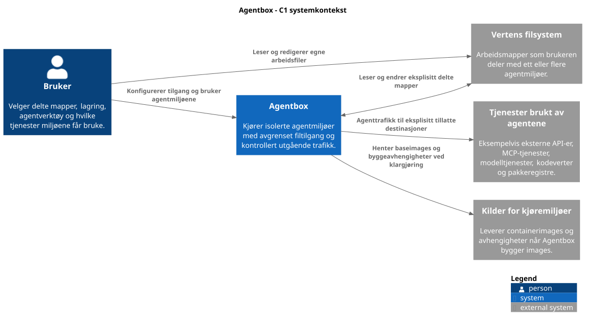

# Agentbox 1.0

Agentbox lar deg kjøre kodeagenter mot utvalgte prosjektmapper på Linux.
Du beholder filene i editoren din, mens agenten arbeider i en container og
bare får utgående nettverkstilgang til destinasjoner du har tillatt.
Flere prosjekter, miljøer og kompatible images kan brukes samtidig.

En egen vertsbruker, `agentbox`, kjører Docker uten root-rettigheter.
Prosjektmapper deles med filrettigheter (ACL-er) og eksplisitte monteringer.
En Squid-proxy håndhever listen over tillatte nettverksdestinasjoner.
Det medfølgende utviklingsimaget inneholder Codex CLI 0.166.0.



[C4-arkitekturen](docs/architecture-c4.md) forklarer systemkonteksten og de
kjørbare delene. Containerne deler vertens kjerne. Et utbrudd med `agentbox`
sine rettigheter kan nå alle prosjekter brukeren har fått tilgang til.

## Kom i gang

Installer først Docker Engine med rootless-støtte og prosjektets
forutsetninger etter [installasjonsveiledningen](docs/installation.md).
Kjør deretter fra repoet:

```sh
sudo scripts/install.sh --operator "$(id -un)"
agentbox doctor
agentbox build-images
source <(agentbox completion bash)
```

Registrer et prosjekt som allerede finnes:

```sh
agentbox project add pubnix --path "$HOME/src/pubnix"
mkdir -p "$HOME/.config/agentbox/environments"
```

Et prosjekt er en vertsmappe med tildelt tilgang. Et miljø er en navngitt
container med valgt image, mounts og nettverkspolicy. Registrering av en
mappe oppretter ikke et miljø.

Lagre dette som `~/.config/agentbox/environments/pubnix-codex.yaml`, utenfor
mappene agenten kan redigere:

```yaml
name: pubnix-codex
image: agentbox-dev:local
workdir: /home/agent/src/pubnix
command: ["bash"]
mounts:
  - project: pubnix
    target: /home/agent/src/pubnix
    mode: rw
network:
  allow: []
```

Start og åpne miljøet:

```sh
agentbox validate "$HOME/.config/agentbox/environments/pubnix-codex.yaml"
agentbox start pubnix-codex --config "$HOME/.config/agentbox/environments/pubnix-codex.yaml"
agentbox shell pubnix-codex
```

Dette åpner Bash i prosjektmappen med nettverket stengt. Endringer i montert
kode lagres direkte på verten. Miljønavnet beskriver planlagt Codex-bruk;
start med Bash for å kontrollere filtilgang. Følg
[bruksveiledningen](docs/usage.md) for nettverk, Codex-innlogging og daglig bruk.

`exit` lukker skallet. `agentbox stop pubnix-codex` stopper miljøet og beholder
hjem og innlogging. `agentbox remove pubnix-codex` sletter containerlaget,
inkludert innlogging og verktøyoppsett. Monterte prosjektfiler beholdes.

## Dokumentasjon

| Dokument | Bruk det til |
| --- | --- |
| [Installasjon](docs/installation.md) | Forutsetninger, oppsett, adresseområde og avinstallasjon |
| [Bruk](docs/usage.md) | Prosjekter, miljøfiler, nettverk, innlogging og feilsøking |
| [C4-diagrammer](docs/architecture-c4.md) | Forstå omgivelsene og programmene som utgjør Agentbox |
| [Arkitektur](docs/architecture.md) | Eierskap, kontroll, filtilgang og sikkerhetsgrenser |
| [Spesifikasjon](docs/specification.md) | Produktkontrakten for Agentbox 1.0 |
| [Arkitekturvalg](docs/decisions.md) | Begrunnelser og konsekvenser av isoleringsmekanismene |
| [Utvikling](docs/development.md) | Lokale kontroller og disponibel testlab |
| [Teststatus](docs/test-results.md) | Observerte resultater og testavgrensninger for 1.0 |

Versjon 1.0 er prøvd i Ubuntu-VM og manuelt på utviklerens Debian-vert.
Linked worktrees, separat profillagring og sterkere isolering per prosjekt
inngår ikke i versjonen. Sammenligning med OpenShell og Docker Sandboxes er
videre arbeid. Den [opprinnelige implementeringsplanen](docs/history/implementation-plan-mvp.md)
er bevart som historikk.
