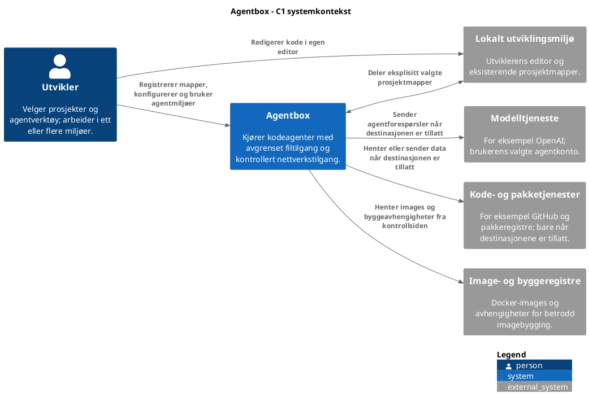
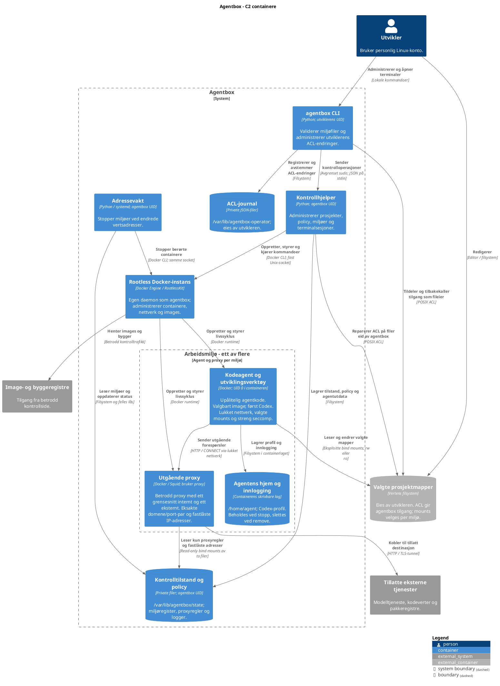

# Agentbox på C4 nivå 1 og 2

Diagrammene viser dagens MVP. C1 viser systemet og omgivelsene; C2 viser
kjørbare deler, datalagre og forbindelsene mellom dem.

En C4-container betyr et program eller et datalager. Begrepet er bredere enn
en Docker-container: CLI-en og kontrollhjelperen er også C4-containere.
Alle interne deler kjører på samme Linux-vert. Test-VM-en er et labmiljø og
inngår ikke som et krav i produktarkitekturen.

## C1 systemkontekst


<details>
<summary>PlantUML-kilde</summary>



</details>

Agenttrafikk er avvist som standard. Listen over tillatte destinasjoner
gjelder agentenes nettverkstrafikk; imagebygging og imagehenting utføres på
den betrodde kontrollsiden. At dette repoet finnes på GitHub gir ikke
agentene automatisk GitHub-tilgang.

## C2 containere


<details>
<summary>PlantUML-kilde</summary>



</details>

### Grensene som betyr mest

- Den stiplede systemgrensen angir produktets omfang. Miljøgruppen samler
  agent, proxy og hjemmekatalog; nettverkstilgang følger pilene og nodenes beskrivelser.
- Utviklerkontoen og `agentbox` er separate vertsbrukere. Kontrollhjelperen
  kjører utenfor agentcontainerne; kode og private kontrollfiler monteres ikke inn.
- Én agent og én proxy vises. Hvert ekstra miljø får sitt eget par og egne
  nettverk. Docker-instansen og kontrollsiden er felles.
- Agenten har ingen forbindelse til Docker-socketen og ingen direkte
  internettrute. Pilene fra Docker viser styring, ikke en kontrollkanal agenten kan bruke.
- Proxyen monterer bare proxykonfigurasjonen skrivebeskyttet. Kontrollhjelperen
  gjør navneoppløsning og adressevalidering før de fastlåste adressene tas i bruk.
- Prosjektmapper ligger på verten og overlever fjerning av miljøet. Agentens
  hjem ligger i containerlaget; separat profilvolum er fortsatt et mulig videre valg.
- Rootless-containerne deler vertens kjerne. Ved et utbrudd med `agentbox`
  sine rettigheter gjelder brukerens samlede vertstilgang, også til andre registrerte prosjekter.
  Agentens UID 0 mappes til tjenestebrukeren på verten; proxyen bruker en egen
  containerbruker og får ikke prosjektmapper montert inn.

## Vedlikehold av diagrammene

Navngitte PlantUML-blokker i dette dokumentet er kilden til SVG- og PNG-filene
i `docs/diagrams/`. Kilden og bildene skal oppdateres sammen:

```sh
python3 scripts/render-diagrams.py
python3 scripts/render-diagrams.py --format png
```

PlantUML med lokalt C4-bibliotek og Graphviz må være installert.

```sh
python3 scripts/render-diagrams.py --jar /sti/til/plantuml-1.2026.9.jar
```

Nivåene følger C4-modellens beskrivelser av
[systemkontekst](https://c4model.com/diagrams/system-context) og
[containere](https://c4model.com/diagrams/container). Konkret oppførsel og
begrensninger beskrives i [implementasjonsvalgene](decisions-mvp.md).
