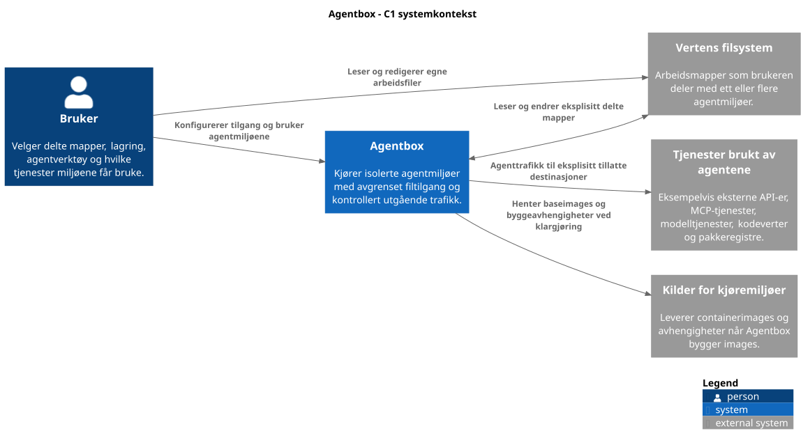
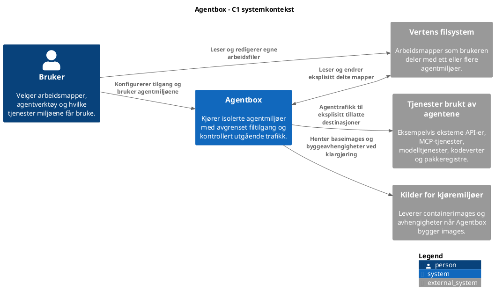
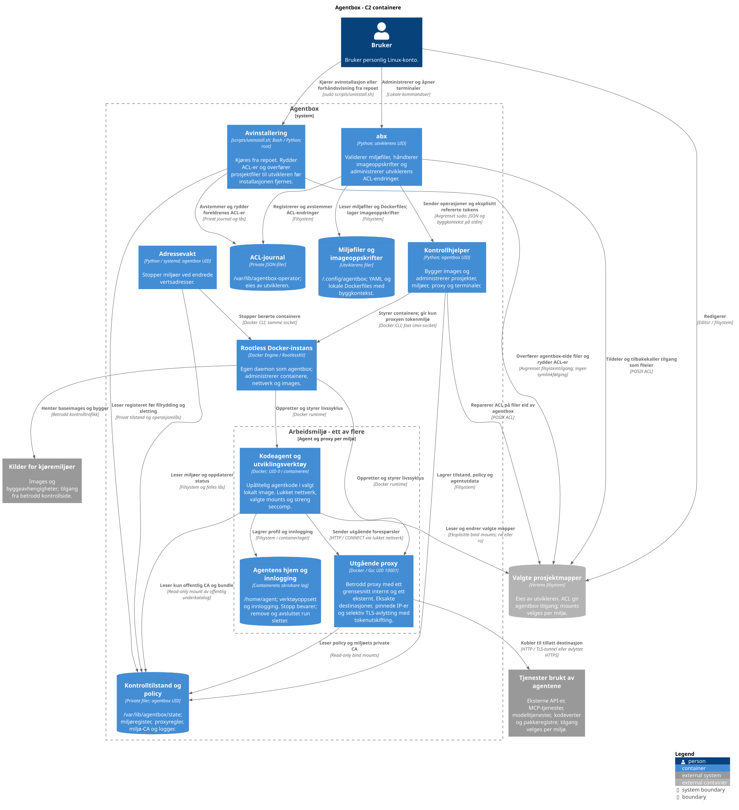
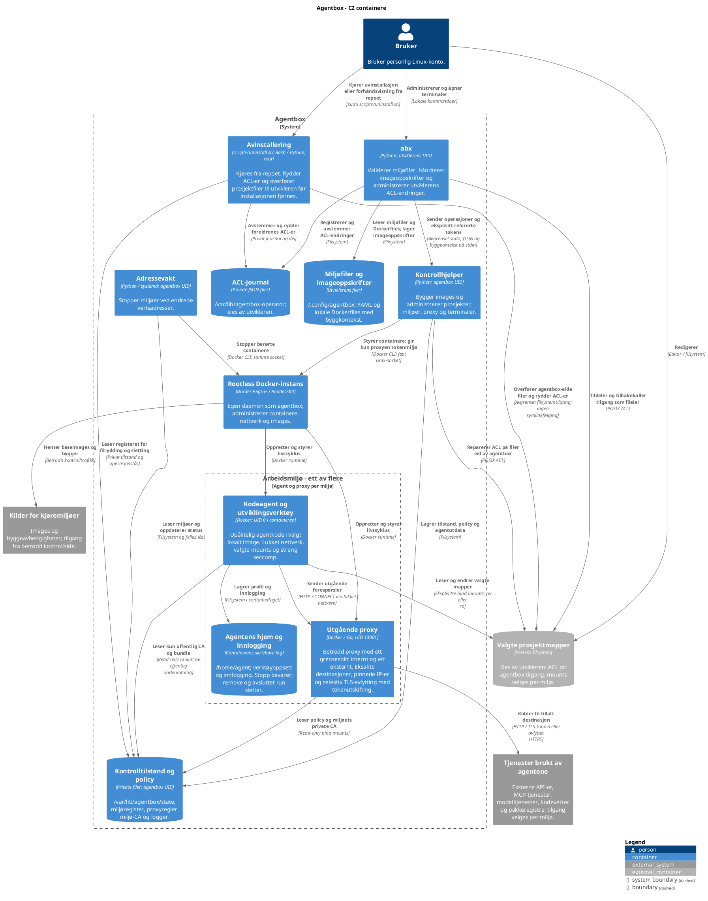
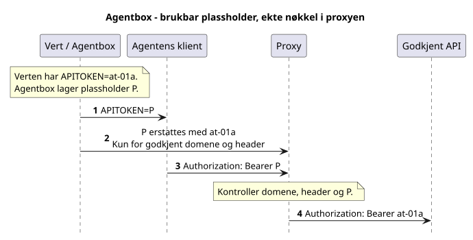
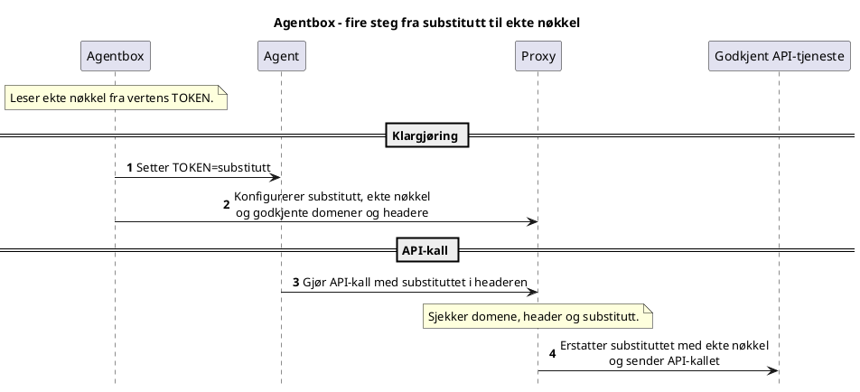

# Agentbox på C4 nivå 1 og 2

Agentbox kjører kodeagenter med valgte prosjektmapper og kontrollert utgående
nettverkstilgang. C1 viser systemet og omgivelsene; C2 viser
kjørbare deler, datalagre og forbindelsene mellom dem.

En C4-container betyr et program eller et datalager. Begrepet er bredere enn
en Docker-container: CLI-en og kontrollhjelperen er også C4-containere.
Alle interne deler kjører på samme Linux-vert. Test-VM-en er et labmiljø og
inngår ikke som et krav i produktarkitekturen.

## C1 systemkontekst



<details>
<summary>PlantUML-kilde</summary>



</details>

De eksterne tjenestene grupperes etter hvordan de inngår i Agentbox:
agentenes arbeid og klargjøring av kjøremiljøer. Dette er roller, ikke faste
leverandører eller konfigurerte integrasjoner. Samme eksterne system kan
brukes i begge roller, eksempelvis et pakkeregister.

API-er og MCP-tjenester kan brukes når miljøets destinasjonsregler tillater
det. Agentbox tilbyr ikke selv et MCP-grensesnitt. Agenttrafikk avvises som
standard; imagebygging og henting av baseimages skjer på kontrollsiden utenfor denne
nettverkspolicyen. C2 viser hvilke deler som håndterer de to trafikkveiene.

## C2 containere



<details>
<summary>PlantUML-kilde</summary>



</details>

### Grensene som betyr mest

- Den stiplede systemgrensen angir produktets omfang. Miljøgruppen samler
  agent, proxy og hjemmekatalog; nettverkstilgang følger pilene og nodenes beskrivelser.
- Utviklerkontoen og `agentbox` er separate vertsbrukere. Kontrollhjelperen
  kjører utenfor agentcontainerne; kode og private kontrollfiler monteres ikke inn.
- Én agent og én proxy vises. Hvert ekstra miljø får sitt eget par og egne
  nettverk. Docker-instansen og kontrollsiden er felles.
- Agenten har ingen forbindelse til Docker-socketen og ingen direkte
  internettrute. Pilene fra Docker viser styring, ikke en kontrollkanal agenten kan bruke.
- Proxyen leser policy og nødvendig privat CA fra skrivebeskyttede mounts;
  ekte tokens tilføres bare proxyens miljø. Kontrollhjelperen gjør navneoppløsning
  og adressevalidering før de fastlåste adressene tas i bruk.
- Prosjektmapper ligger på verten og overlever fjerning av miljøet. Agentens
  hjem ligger i containerlaget; separat profilvolum støttes ikke.
  Midlertidige miljøer fra `run` fjernes når kommandoen avsluttes.
- Rootless-containerne deler vertens kjerne. Ved et utbrudd med `agentbox`
  sine rettigheter gjelder brukerens samlede vertstilgang, også til andre registrerte prosjekter.
  Agentens UID 0 mappes til tjenestebrukeren på verten; proxyen bruker en egen
  containerbruker og får ikke prosjektmapper montert inn.

## Sekvens: fra miljøvariabel til ekte API-nøkkel

Agentbox setter en substituttverdi i agentens miljøvariabel `TOKEN`.
Substituttet er en generert plassholder. Den ekte nøkkelen fra vertens miljø
gis til proxyen, som kan bytte den inn når agenten bruker riktig header mot
et godkjent mål.

Diagrammet viser hovedflyten for en HTTPS-destinasjon med nøkkelregel.
Opprettelse av containere og TLS-forbindelser er utelatt.



<details>
<summary>PlantUML-kilde</summary>



</details>

Agenten har en verdi den kan bruke, men den ekte nøkkelen ligger på den
betrodde siden. Uten riktig plassholder, header og destinasjon setter proxyen
ikke inn nøkkelen.

Substituttet beholdes ved stopp/start og proxybytte, også når operatøren
roterer den ekte nøkkelen. Nye variabelnavn krever eksplisitt gjenskaping av
agentcontaineren. Hvert miljø har sitt eget plassholderkart.

Ekte tokenverdier tilføres via CLI og kontrollhjelperens stdin til proxyens
miljø. Docker lagrer miljøet i metadata; full kontroll over tjenestebrukeren
og daemonen kan avsløre nøkkelen. En godkjent tjeneste kan også returnere den
i et svar. Se [oppsett og avgrensninger](usage.md#api-tokens-i-proxyen).

## Vedlikehold av diagrammene

Navngitte PlantUML-blokker i dette dokumentet er kilden til SVG- og PNG-filene
i `docs/diagrams/`. Kilden og bildene skal oppdateres sammen:

```sh
python3 scripts/render-diagrams.py
python3 scripts/render-diagrams.py --format png
```

PlantUML med lokalt C4-bibliotek og Graphviz må være installert.

```sh
python3 scripts/render-diagrams.py --jar /sti/til/plantuml-1.2026.9.jar
```

Nivåene følger C4-modellens beskrivelser av
[systemkontekst](https://c4model.com/diagrams/system-context) og
[containere](https://c4model.com/diagrams/container). Konkret oppførsel og
begrensninger beskrives i [implementasjonsvalgene](decisions.md).
